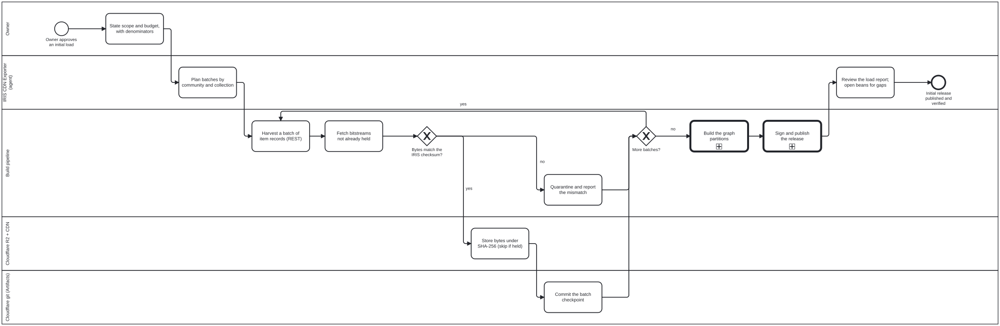
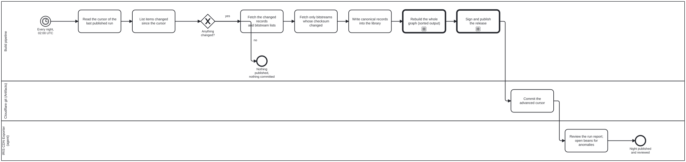
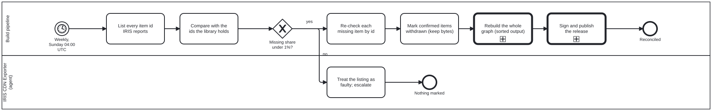
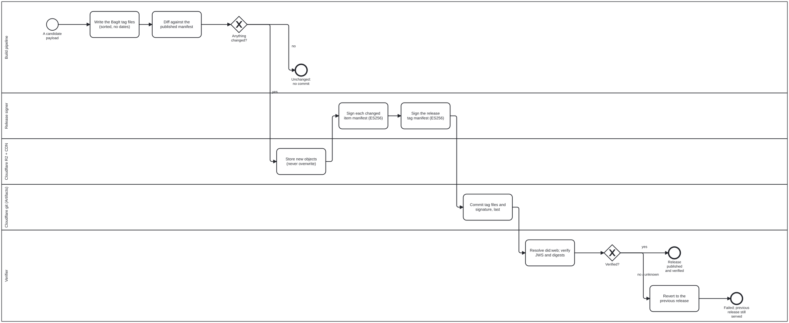

# IRIS CDN Exporter: processes

How WHO IRIS gets from its DSpace server to a signed, versioned copy on
Cloudflare: one initial load, then a nightly change ingest, a weekly
reconciliation, and one signed release per run. Issue
[litlfred/who-iris#100](https://github.com/litlfred/who-iris/issues/100).

The diagrams below are rendered from the BPMN files in
[`processes/`](../processes/). The BPMN files are the source of truth, and
each step names the skill that carries it out. Where the infrastructure runs
and where the keys live is covered in [deployment](iris-cdn-deployment.md).

## What the owner decided (2026-10-30)

| Question | Answer |
|---|---|
| How much does the initial load cover? | Metadata **and the PDFs** |
| Where do changes come from? | The **DSpace REST API** only |
| Where do exports live? | **Cloudflare**: a git repository on Cloudflare Artifacts (not GitHub), and R2 behind the Cloudflare CDN |
| What is GitHub Pages for? | **Previews only.** `litlfred/who-iris` and `WHO/who-iris` preview the full exported site, and keep materialized only the three items held today, for testing |
| How is the graph regenerated? | **Full rebuild every night.** Sorted output keeps unchanged partitions byte-identical |
| What runs the exporter? | **GitHub Actions**, writing to Cloudflare |
| Where is the signing key? | A GitHub **environment secret** (`iris-cdn-release`, `main` only) |
| How is each item signed? | A **detached JWS per library item**, over a manifest of its record and files, **plus one over the release** (Q4 A). Only changed items are re-signed |
| How are keys published? | As `verificationMethod`s of a **`did:web`** DID document, with `publicKeyJwk.x5c` chaining to WHO's signing DID. The key is **already published**, and the exporter only uses it. GDHCN is not assumed |
| Standing requirement | **No churn**: content that has not changed is not rewritten, re-uploaded or re-signed |

## Actors

| Lane | Who or what |
|---|---|
| Owner | Approves scope, budget and the storage target |
| IRIS CDN Exporter (agent) | Plans and reviews, and opens beans for anomalies. Never holds the key, and never pushes to a WHO repository |
| Build pipeline | The scripts in `scripts/iris-cdn/`, run by GitHub Actions. Same input, same bytes |
| Release signer | Holds the P-256 private key and signs what changed |
| Cloudflare git (Artifacts) | A git repository on Cloudflare holding the release history: BagIt tag files, signatures, cursor, checkpoints and run reports |
| Cloudflare R2 + CDN | Every byte named by its SHA-256 and served with an immutable cache. Also serves `did.json` |
| Verifier | Anyone. Resolves the key from the DID document, never from the package |

## 1. Initial load

`processes/iris-cdn-initial-load.bpmn`. The load runs in batches of one
collection each. After every batch it commits a checkpoint, so a stopped load
resumes where it left off. Bytes that fail the IRIS checksum are quarantined,
not published.

## 2. Nightly change ingest

`processes/iris-cdn-nightly.bpmn`. The pipeline lists the items IRIS changed
since the cursor, fetches only those, and rebuilds the graph. If nothing
changed, it publishes nothing and makes no commit. The cursor moves forward
only after the release verifies.

## 3. Weekly reconciliation

`processes/iris-cdn-reconcile.bpmn`. REST does not report deletions, so once a
week every item ID is compared with what the library holds. If more than 1% of
held items are missing, the listing is treated as faulty and nothing is marked.
Withdrawn items are marked as withdrawn and their bytes stay addressable.

## 4. Sign and publish (called by all three)

`processes/iris-cdn-sign-publish.bpmn`. Each changed library item gets a
detached JWS (RFC 7515 Appendix F, ES256) over its own manifest. The release
is a BagIt bag (RFC 8493) whose tag manifest pins every item manifest and
signature, and the tag manifest is signed once. Payload objects go to R2 first. The tag files and the signature are
committed to Cloudflare git last, in one commit. A release that does not verify
is reverted, and the previous release stays served.

## The signing key

**Given, not modelled here.** The subordinate signing key is already
published in a DID document, with `publicKeyJwk.x5c` chaining to WHO's signing
DID, and its private JWK is already in the GitHub environment secret
`IRIS_CDN_SIGNING_JWK`. How that key was created and certified happens
offline and outside these processes (owner, 2026-10-30). The exporter only
uses the key.

## When metadata changes and the PDF does not

A record and its files are stored and diffed separately. A Dublin Core edit
produces a new record, and therefore a new digest, while the PDF keeps its
digest and is not fetched again. Renamed communities and collections are
caught by re-reading them nightly. Edits that do not move `lastModified` are
caught by the weekly metadata hash check. See the skill `iris-rest-feed`.

## How churn is kept to a minimum

1. Records are canonical JSON: sorted keys, LF line endings, no fetch time
   inside. An unchanged record is not rewritten.
2. Bitstreams are named by SHA-256. A byte that is already stored is never
   fetched, uploaded or overwritten again.
3. The graph is rebuilt in full, but its N-Quads are written sorted. A
   partition with no changed item comes out byte-identical and is not
   re-uploaded.
4. `bag-info.txt` carries no date, so an unchanged payload has an identical
   tag manifest and needs no new signature.
5. An empty diff ends the run: no commit and no signature.

## Skills and code

| Skill | What it covers |
|---|---|
| [`iris-cdn-exporter`](../skills/iris-cdn-exporter.md) | The agent role, the no-churn rule, and where things live |
| [`iris-rest-feed`](../skills/iris-rest-feed.md) | The DSpace REST change walk, the weekly reconciliation, fixity |
| [`iris-cdn-signing`](../skills/iris-cdn-signing.md) | BagIt, the detached JWS, `did:web`, key rotation |
| [`iris-oxigraph`](../skills/iris-oxigraph.md) | The graph partitions the rebuild produces |
| [`iris-dspace`](../skills/iris-dspace.md) | What an IRIS record holds |

The code is in `scripts/iris-cdn/`: `bag.ts`, `signing.ts` and `rest-feed.ts`.
Its tests are `scripts/tests/iris-cdn.test.ts`.

The platform processes these call are in cat-harness:
`processes/kg/nquads-distribution.bpmn` (graph partitions),
`processes/kg/named-query-execution.bpmn` (prepared SPARQL) and
`processes/kg/kg-to-portal.bpmn` (the general select, package, sign,
distribute and verify pattern).

## Still open

- **CDN and DID domain.** The proposal is a stable domain the owner adds to
  Cloudflare.
- **Live endpoint shapes.** iris.who.int could not be reached from the sandbox
  where this was written. The first run must confirm the DSpace REST shapes
  that `rest-feed.ts` assumes.
