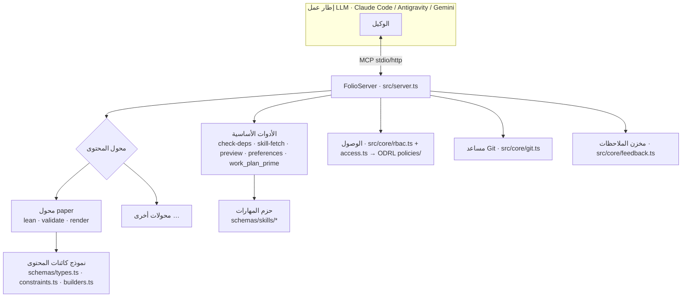

# الهندسة المعمارية
{: .no_toc }

1. TOC
{:toc}

---

## نظرة عامة

> **القواعد الكامنة وراء هذه الصفحة.** تصف الهندسة المعمارية الهيكل؛ بينما تحكم
> المهارات القرارات. المحولات مقابل ملفات التعريف —
> [`content-profiles`]({{ '/reference/skill-instructions/content-profiles.html' | relative_url }}).
> أين تنتمي العقدة الجديدة قبل إنشائها —
> [`placement`]({{ '/reference/skill-instructions/placement.html' | relative_url }}). وتخطيط المستودع
> وكل نوع من أنواع الرسوم البيانية —
> [`directory-conventions`]({{ '/reference/skill-instructions/directory-conventions.html' | relative_url }}).
> وتركيب واجهة MCP والتحقق منها —
> [`mcp-assembly`]({{ '/reference/skill-instructions/mcp-assembly.html' | relative_url }}) و
> [`mcp-contract`]({{ '/reference/skill-instructions/mcp-contract.html' | relative_url }}).
> وحيثما تختلف هذه الصفحة مع إحدى المهارات، فإن المهارة هي التي تسود.

إن folio-assistant هو **خادم MCP** يضم طبقة **محولات محتوى** قابلة للتوصيل،
ونظام **مهارات**، و**نموذج كائنات محتوى** مصنف بالأنواع، ونظام **تحكم في الوصول قائم على الأدوار (RBAC)**،
وآلية نشر. ويعيش المحتوى الذي يعمل عليه في مستودع *منفصل* — فالمنصة
مستقلة عن المحتوى.

## فصل الاهتمامات — الوضع الحالي والمستقبلي

تصف الصفحات الفرعية تقسيم المنصة إلى حالات (instances) قابلة للتركيب:

| الصفحة | ما تجيب عليه |
|---|---|
| [تصنيف المستودعات](../architecture/repo-taxonomy.html) | ما هي أنواع المستودعات الموجودة — أداة (Tool)، واختبار (Test)، ومحتوى (Content)، ومستهلك (Consumer) — وما قد يحتويه كل منها |
| [الوضع الحالي](../architecture/current-state.html) | ما هو موجود بالفعل في هذا المستودع اليوم، بالأرقام المقاسة، وأين يكمن المزيج |
| [الوضع المستقبلي](../architecture/future-state.html) | المستودعات الخمسة المستهدفة وأي دليل يستقر في أيّ منها |
| [خطة الانتقال](../architecture/migration-plan.html) | المراحل 0/I/II/III، والبوابات، وما لم يُحسم بعد |
| [الحد الأدنى لـ `cat-harness`](../architecture/cat-harness-minimum.html) | ما يتبقى في إطار العمل (harness) بمجرد تطبيق معيار "ليس توثيقًا ذاتيًا" كاختبار |
| [حالات إطار العمل](../architecture/harness-instances.html) | ما هي الحالة (instance) في واقعها — المخططات، والتصورات المرئية، والأدوات؛ والأدلة الأربعة؛ والتصيير الافتراضي |

ينص الحد الأدنى على أن إطار العمل لا ينتج شيئًا ينظر إليه إنسان، وتنص صفحة الحالات على أن الحالة تقوم بالتصيير افتراضيًا؛ ويصح الأمران لأن متطلب التصيير هو **حد أدنى يرتفع تدريجيًا**، مع إعفاء `bootstrap` من أداة التصور المرئي مع التزامه بتقديم `.json`/`.jsonld` الخاصة به بدلاً من ذلك، في حين يمثل `cat-harness` الطبقة التي يبدأ عندها تطبيق الباقي. راجع
[أين يبدأ المتطلب](../architecture/harness-instances.html#where-the-requirement-starts--bootstrap-is-the-exception).

يصف باقي هذه الصفحة الهندسة المعمارية **كما هي عليه الآن**.

## تخطيط المستودع

القائمة المرجعية هي `cat-harness.json`: كل دليل تعلنه هذه الطبقة، مع نوع الرسم البياني الذي يحمله. الأدلة التي يبحث عنها القارئ أولاً:

| المسار | ما يحتويه |
|------|-----------------|
| `skills/` | رسم المعرفة البياني: حزم المهارات (`skills/<area>/<package>/`، ولكل منها `package-manifest.json`)، والأدوار، والأذونات، والمتطلبات |
| `processes/` | عمليات BPMN القابلة للتنفيذ وجداول DMN التي تحسب منها بواباتها |
| `schemas/` | مخططات JSON لكل مهارة (`schemas/skills/`) ووثائق المخططات التي يعلنها إطار العمل |
| `tools/` | تعريفات الأدوات، ملف `tools/<id>/<id>.json` لكل أداة |
| `policies/` | ما يحق للفاعل فعله، على شكل سياسات W3C ODRL 2.2 |
| `sdlc/`، و`work-plan/` | الرسمان الفرعيان لتسليم البرمجيات ولخطة العمل |
| `library/`، و`uploads/` | محتوى المصادر L1 المستوعَب، والطابور الذي يُستوعَب منه |
| `docs/` | موقع التوثيق هذا |
| `.github/` | مهام سير عمل CI |

شفرة الخادم والمحولات والبرامج النصية المذكورة في هذه الصفحة (`src/`، و`adapters/`، و`scripts/`، و`deploy/`) ليست في هذه الطبقة؛ بل تُشحن مع طبقة الأدوات.

## خادم MCP

يقوم `FolioServer` (`src/server.ts`) بتسجيل الأدوات الأساسية، ثم يطلب من **محول المحتوى** النشط تسجيل أدواته. وهو يدعم وسيلتي نقل — `--stdio` (التي تشغلها أطر العمل) و`--http` (حالة مشتركة طويلة التشغيل). ويتم تسجيل استدعاءات الأدوات مع توقيتاتها.

## محولات المحتوى

يغلف محول المحتوى كل ما يخص نوعًا معينًا: ما هي المخرجات (artifacts) الموجودة، وكيفية التحقق منها، وكيفية بنائها/تصييرها، وما هي أدوات MCP الإضافية التي يجب تسجيلها. ويعد محول `document` (`adapters/document/`) هو الأساس لملفات المحتوى النثرية؛ بينما يوسعه محول `paper` (`adapters/paper/`) ويوفر أدوات دورة حياة Lean (`lean_setup`/`build`/`check`/`status`)، والتحقق، والتصيير (`paper_render_pdf`/`html`، و`formula_render`). وتضيف أنواع المحتوى الجديدة محولاً جديدًا — راجع [إضافة نوع محتوى](../../guides/new-content-type.html).

## المهارات وحزم المهارات

الـ **مهارة** (skill) هي وحدة عمل موثقة ومقيدة بمخطط بياني (مثل `lean-formalization`). وتُجمع المهارات في **حزم** تعلن عن تبعات Docker وبيئة التشغيل الخاصة بها عبر ملف `package-manifest.json`. ويكتشف النموذج اللغوي الكبير (LLM) المهارات عبر `skill_list` ويحمّل التعليمات عبر `skill_fetch`. وتوجد القائمة الكاملة للمهارات والأدوار — وكيفية تكاملها مع النموذج اللغوي الكبير (RBAC، والقدرات، والمتطلبات) — في صفحة [المهارات والأدوار](skills.html)؛ كما يُنشر عقد المدخلات/المخرجات لكل مهارة في [مرجع مخططات المهارات]({{ '/reference/skills/' | relative_url }}).

## نموذج كائنات المحتوى

بالنسبة للأوراق العلمية، فإن المحتوى هو شجرة من **الكتل** (blocks) محددة الأنواع يتم التحقق منها أثناء التشغيل عبر Zod:

- `schemas/types.ts` — `Block`، و`Section`، و`Chapter`، و`Paper`، وأنواع الكتل
- `schemas/constraints.ts` — مخططات Zod وقواعد القيود
- `schemas/builders.ts` — بناة الكائنات التي تم التحقق منها (`definition()`، و`theorem()`، …)

وهذه العناصر موثقة في [مرجع واجهة برمجة تطبيقات TypeScript]({{ '/ar/api/' | relative_url }}) المُولّد.

## التحكم في الوصول — ODRL، يتم التحقق منه قبل كل مهمة

يوجد نظام أذونات واحد فقط، وهو W3C ODRL 2.2: الإجراءات في `skills/permissions/permissions.json`، والمنح في `policies/*.jsonld`، ويتم تقييمها عبر `permits()` / `decide()` في `schemas/odrl.ts`. ويستعلم عنه طرفان مستدعيان:

- **مُنفِّذ BPMN**، قبل كل مهمة وقرار (`src/workflow/authorize.ts`): هل الفاعل موثق، ومؤهل لدور المسار (lane)، ومصرح له بـ `perform-task` هنا، ومسموح له بلمس المحتوى؟ وهو استشاري اليوم: فالرفض `deny` أو عدم تطابق الدور يؤدي إلى الرفض، ويتم تسجيل الحالة `unknown`.
- **مسارات HTTP**، من خلال `src/core/rbac.ts`: يحدد كل مسار الإجراء الذي ينفذه (`content-authoring`، و`review-comments`، و`adjudication`)، وتُعد جلسات بوابة المصادقة (auth-gateway) فاعلين معلنين تكمن منحهم في `policies/http-gateway.jsonld`. وهنا تؤدي الحالة `unknown` إلى الرفض.

والانضباط المتبع هو مهارة [`task-authorization`]({{ '/reference/skill-instructions/task-authorization.html' | relative_url }}).

## تهيئة خطة العمل (عبر أطر العمل المختلفة)

يتم تخزين خطة العمل في `beans` وإبرازها بثلاث طرق حتى تتم تهيئة أي إطار عمل بشكل متطابق:

1. **`AGENTS.md`** — انضباط ثابت، يقرؤه كل وكيل أصلاً.
2. **خطاف `SessionStart`** — يشغل كل إطار عمل برنامج التهيئة المشترك `scripts/session-start-coord-sweep.sh`.
3. **أداة MCP المعنونة `work_plan_prime`** — تهيئة حية ومباشرة لأي وكيل متصل بـ MCP.

راجع `docs/folio-assistant-migration.md` للاطلاع على التصميم الكامل المشترك بين الوكلاء.

## النشر

يحتوي `deploy/` (طبقة الأدوات) على قالب خادم وكيل عكسي (reverse-proxy) لـ Caddy، وملف `docker-compose.yml`، وبرنامج نصي للإعداد والتهيئة، وإعداد Google OAuth، وبرنامج نصي للتحديث الذاتي لتشغيل حالة HTTP مشتركة. وتجمع بيانات Docker الخاصة بحزم المهارات تبعات apt/pip/npm في صورة واحدة لكل مجموعة حزم نشطة.
