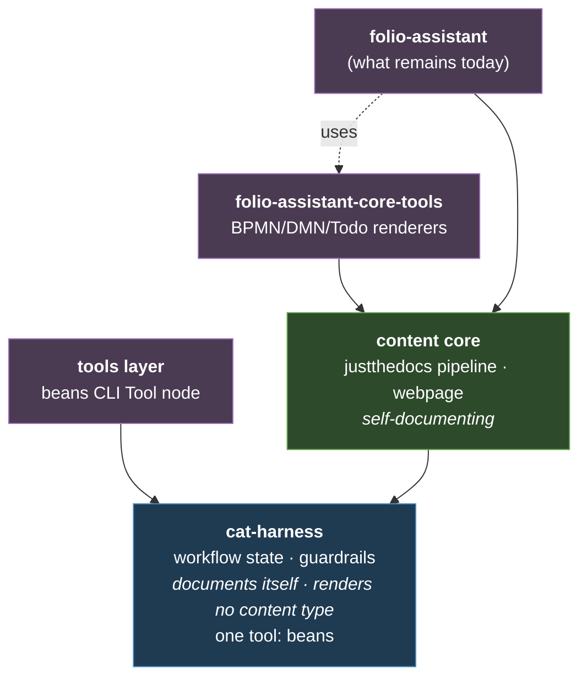

# The minimum `cat-harness` — and what moves where
{: .no_toc }

1. TOC
{:toc}

---

> What survives in `cat-harness` once *"renders no content type"* is applied as
> a test, and how the Tools schema that the harness owns is carried.

## The repo set

Content rendering lives outside the harness, and each layer has a Tools sibling:




## What "renders no content type" constrains

**The harness documents itself, but it renders no content type.** Its own
`docs/` is published as its site, so a reader can learn how the harness works.
The `webpage` content type and every renderer of a content type belong to the
content core.

That yields a one-line admission test for every candidate:

> **If it renders a content type, it is not the harness.**

The webpage content type, the sticky-note Todo rendering, the QR code, the
audit-sidecar iconography — all present a folio's content to a reader, so all
belong to the content core or `folio-assistant-core-tools`.

What survives in the harness is the part with no pixels: **schemas, process
definitions, and skills that tell an agent how to behave.** The test is
falsifiable: if `cat-harness` ends up with dozens of skills and no crisp line
against core, the test has not constrained anything.

## `cat-harness` — the minimum

### Schemas (`.ts`, minimal)

The harness owns the vocabulary of *work*, not of *content*.

| schema | why the harness |
|---|---|
| `Skill` | what an actor knows how to do |
| `Tool` | how work actually gets done; a KG node, not a shell string |
| `Task` | the unit assigned to an actor in a swimlane |
| `Actor` / `Role` | who may do what — RBAC |
| `Process` (BPMN) / `Decision` (DMN) | the deterministic workflow itself |
| `Todo` | user/agent workflow state |
| `Bean` | the agent work plan; a workflow-state format with no schema cannot be validated, carry a QA sidecar, or be a KG node |
| `CatHarness` declaration | which directories an instance scans, and each one's graph typology |
| `Content` (abstract) | the *base* only: identity, label, provenance. No block kinds, no profiles. |

### Skills — 24: 21 from `folio-core`, plus 3 written for MCP projection

Classified by reading each skill's description, not its filename.

| skill | why the harness |
|---|---|
| `bean-coordination` | cross-session claim discipline |
| `todo-manager` | work-plan maintenance: the CLI, the STRICT create-check, coordination |
| `opening-brief` | brief a work item or topic before touching anything |
| `turn-reporting` | say which work item you are on, every turn |
| `pending-show` | read-only view of session pending work |
| `session-intent` | session-start intent, session-end results |
| `continual-progress` | PR from the first commit; visibility of in-flight work |
| `coordinate` | multi-PR coordination toward a shared goal |
| `pickup` | resume an existing open PR |
| `watch` | background-watch a branch or PR |
| `prepare-merge-auto` | the merge pipeline as a process |
| `idle-backlog` | what an agent does while blocked |
| `dispatch-agent` | background sub-agents — the swarm entry point |
| `interaction-modality` | how to talk to the person before deciding what to say |
| `symbiotic-interaction` | the three epistemic registers of author input |
| `crdm-detect` | feature-request detection |
| `crdm-requirements-workflow` | the six-phase process |
| `getting-started` | folio-creation triage |
| `repo-conversion` | laying the harness over an existing repo — bootstrap |
| `integration-watcher` *(abstract parent only)* | the shared watcher mechanics; the concrete watchers are downstream |
| `directory-conventions` | the declaration and its graph typologies |
| `process-state` | reading a BPMN swimlane as process state for the role you are playing, and recovering when you find yourself outside it |
| `skills-and-tools` | the skill/Tool separation — the SOP every other skill follows |
| `mcp-projection` *(new)* | mapping a Tool node onto the MCP standard — how an agent stands a service up from a CLI tool |
| `mcp-assembly` *(new)* | composing many Tools into one service: naming, collisions, prefixes, versioning |
| `mcp-contract` *(new)* | verifying a served tool still matches the node it was projected from |

The three `mcp-*` skills are **new writing, not moves** — nothing in
`folio-core` covered projection. Where they live now is in
[Skill groups](#skill-groups).

### Documentation — the smallest set

Prose an agent reads, not pages a reader browses:

- the data models above, described as *one deterministic workflow*: Actors with
  Skills work Tasks in a Business Process, assigned by swimlane role;
- context-handling expectations, and work item info/workflow/management;
- a minimal coding policy;
- how Tools are made available in shell/CLI and optionally as MCP, and how a
  Task's I/O corresponds to a Tool's inputs and outputs.

### Tools — what the harness itself depends on

The harness holds **work items and nothing else** as a *dependency* — a statement
about what must be installed, not about how many Tool nodes exist. Its own work
needs these nodes:

| Tool node | satisfies | invocation |
|---|---|---|
| `beans-cli` | the six work-plan skills | `shell` — installed by `scripts/install-beans.sh` |
| `beans-manual` | the same six | `shell` — `scripts/beans-fallback.ts`, or a hand edit of the front matter |
| `github` | the four PR-choreography skills | `shell` — `gh`, or the REST call it wraps |
| `pages-publish` | `kg-export` | `shell` — push a directory to the `gh-pages` branch |

**Two work items nodes, not one.** The CLI is absent from a fresh container, and an
agent that knows only the CLI reads the plan and touches nothing. The fallback
is a Tool of equal standing, which forces the skill to say *when* to reach for
it.

**The harness documents itself, and `pages-publish` also publishes its graph
as data.** Its `docs/` is rendered as its own site; no content type's renderer
is in the harness. Its knowledge graph is published as **data** as well:
`kg-export` serializes it to one JSON document and this Tool puts the document
somewhere. A GitLab Pages or object-store node can satisfy the same
skill.

**The Tool KG stays in the harness**: that is what makes the harness
bootstrappable — it describes its own tools in its own vocabulary, without a
content layer's renderer or a server.

## The tools layer — the minimum

Almost empty by construction:

| item | note |
|---|---|
| `beans` CLI Tool node | install, invoke, I/O contract |
| `install-beans.sh` | the one script |

**All code snippets live here, not in skills.** A snippet in a skill is a Tool
that has not been declared — a QA audit criterion, not a style note.

## The Tools schema — built, and where the strawperson bent

The shipped schema is `schemas/tools/harness-tools.ts` in the tools layer,
the Tool nodes are `tools/<id>/<id>.json`, and
`bun run cat check:tools` gates them in CI. It differs from the strawperson
below in five ways:

- **`invoke.manual`** exists: editing a work item's front matter by hand is a real
  mechanism with equal standing to the CLI, and must not look like an
  unfinished record.
- **`install.none`** exists for the same reason: "nothing to install" and "not
  filled in" must not render identically.
- **`invoke` must carry an arm the harness can run.** A Tool whose only
  invocation is `invoke.mcp` is rejected at parse time, because it is unusable
  by the layer that defines it and would make a projector emit a server that
  proxies itself.
- **`io.*.schema`** is an absolute IRI into a published `$defs` document,
  because an unresolvable reference is the failure the `io` block exists to
  prevent.
- **`satisfies`** must be non-empty, and `check:tools` resolves the names — a
  schema cannot, because it does not read the tree, and an unchecked list is a
  declared-but-absent edge that lets a consumer scan nothing and report a clean
  run.

## Strawperson: the Tools-repo schema

The shape, written in Zod — the authoritative form, with the TypeScript type
inferred from it so there is one definition and not two that can drift:

```ts
// schemas/tool.ts
export const ToolDefinitionSchema = z.object({
  id: z.string(),                                   // stable KG node id
  title: z.string(),
  summary: z.string(),

  /** How to obtain it. */
  install: z.object({
    cli:       z.string().optional(),
    container: z.string().optional(),
    service:   z.string().optional(),
  }),

  /** How to run it, per environment. */
  invoke: z.object({
    shell:     z.string().optional(),
    mcp:       z.object({ tool: z.string() }).optional(),
    container: z.string().optional(),
  }),

  /** The contract a Task binds against — the 16:28 requirement. */
  io: z.object({
    inputs:  z.array(z.object({
      name: z.string(), schema: z.string(), required: z.boolean(),
    })),
    outputs: z.array(z.object({
      name: z.string(), schema: z.string(),
    })),
  }),

  /** Skills this tool can satisfy. One skill may have several tools. */
  satisfies: z.array(z.string()),

  requires: z.object({
    os:      z.array(z.string()).optional(),
    runtime: z.array(z.string()).optional(),
    network: z.boolean().optional(),
  }).optional(),
});

export type ToolDefinition = z.infer<typeof ToolDefinitionSchema>;
```

The `io` block is the part that earns its keep: it lets a Task's inputs and
outputs be checked against the Tool that will execute it.

### Carrying it — authored once in Zod, rendered downstream

**The `.ts` Zod schema is authoritative, and downstream renderings are generated
from it — JSON-LD and JSON Schema to begin with.** Every schema in the harness
is defined this way.

```
schemas/tool.ts            ← AUTHORITATIVE.  Zod + the inferred TS type.
  │
  ├─→ schemas/generated/Tool.schema.json      JSON Schema  (validation, editors)
  └─→ kg/tools/<id>.jsonld                    JSON-LD      (KG node, queryable)
```

Both renderings are derived artefacts: regenerate, never hand-edit, as
`docs/reference/skills/` and `docs/reference/skill-instructions/` are treated.

#### The options

| | **Zod `.ts`, rendered down** | **JSON-LD authored** | **TS, no renderings** | **Skill front-matter** |
|---|---|---|---|---|
| **shape** | one Zod schema; per-tool instances validated against it | one hand-written `.jsonld` per tool | one `.ts` per tool, and nothing else | YAML block in the skill `.md` |
| **author-time checking** | yes | **no** — a typo is a runtime discovery | yes | no |
| **KG node** | yes, generated | yes, natively | **no** — needs a projection nobody wrote | no — unqueryable without parsing Markdown |
| **readable without a TS toolchain** | yes, via the renderings | yes | **no** | no |
| **number of truths** | **one** | one | one | one |
| **verdict** | **decided** | superseded | insufficient | **do not** |

- **A hand-authored JSON-LD node is unchecked until CI runs.** With Zod as the
  type, a malformed tool definition fails at `tsc`, in the editor, before it is
  committed; validation after the fact catches the same error later, and only
  if CI runs.
- **Authoring the rendering and validating backwards would be a fourth
  pattern.** Zod → JSON Schema, Zod → docs and Zod → JSON-LD all run the other
  way.
- **Nothing language-agnostic is lost.** A shell or Python consumer reads the
  generated JSON-LD and JSON Schema as well as a hand-authored one.
- **Front-matter in the skill is rejected**: it contradicts the rule that code
  belongs in tools rather than skills, and it caps the model at one tool per
  skill.

#### What "as many renderings as make sense" means in practice

A rendering earns its place when a real consumer cannot read the ones that
exist: JSON Schema because editors and validators speak it, JSON-LD because the
KG query path does. A third — SHACL, an OpenAPI fragment, Turtle — is added when
something needs it, not in anticipation, because each one is another file to
regenerate and another chance for a stale artefact to be read as current.

**A rendering is never the place a fix lands.** If a generated
`Tool.schema.json` is wrong, the Zod schema is wrong; edit that and regenerate.
A `--check` mode in CI (as `gen-skill-docs.ts --check` uses) enforces it.

## User todo management — proposals

1. **Todo and Work item are the same object at different audiences.** A work item is agent
   work-plan state; a Todo note is a user-authored sticky. Proposal: one schema
   with an `audience` discriminator (`agent` | `human`), and the work item store a
   serialisation of it — two schemas give two answers to "what is outstanding".
2. **Hierarchy**: child Todos and sub-beans for parallel work need
   `parent?: string` plus an ordering key.
3. **Timed blocking**: `blockedOn?: { what, since, expires, handoff }`, so an
   expired block becomes a *signal* and a second agent knows what it inherits.
4. **The rendering is core's, the state is the harness's.** Sticky-note styling,
   drag/resize and position metadata belong in `folio-assistant-core-tools`; the
   Todo schema stays in the harness, so a headless agent can read and write
   Todos with no renderer present.

## The forge is isolated at the Tool layer, not in a repository

**All the PR-choreography skills — `prepare-merge-auto`, `pickup`, `watch`,
`coordinate` — stay in `cat-harness`. There is no `cat-harness-github`
repository.** The skills are forge-neutral prose; only their invocations
(`mcp__github__*`, `gh pr`, `gh api`) are not, and those are a few dozen lines.
A repository boundary is the most expensive cut available, and it would
separate things that are not separable at that grain.

**Isolate at the Tool layer instead.** A skill states the capability
generically; Tool nodes, one per forge operation, carry the invocations and name
the skills they satisfy. Adding GitLab is more Tool nodes against the same
skills — not a repository, not a fork, not a rewrite. The SOP is
[`skills-and-tools`](../../../skills/tools/folio-core/skills-and-tools.md); the
Tool schema's `satisfies` field is exactly this edge.

`repo-conversion` is not merged into `getting-started`, nor
`symbiotic-interaction` into `interaction-modality`: both pairs overlap, but the
merge has no architectural consequence.

### No MCP in the harness — but the harness knows how to emit one

**`cat-harness` assumes no MCP server.** Everything it needs is files in
declared directories, readable with a filesystem and `<name>.json` alone.
`ToolDefinition.invoke` carries `mcp` as **one optional arm** beside `shell` and
`container`, and the harness relies on `shell`.

**MCP is an *output* of this harness, not an input to it.** The three `mcp-*`
skills are how an agent takes a Tool node describing a CLI and produces a
working MCP service from it. An MCP tool declaration is a name, a description
and a JSON Schema for its input; `io.inputs`/`io.outputs` are already the I/O
contract and `invoke.shell` the mechanism, so **the projection is a rename, not
a translation**. An instance with no server loses a transport, not a
capability — which is what keeps sovereign-compute and air-gapped operation
reachable.

## Skill groups

A flat directory of skills gives a reader no way to tell which one governs the
task in front of them, so the `kg` graph is **grouped**, and the group is part
of the address: `skills/<area>/<package>/` (for example `skills/kg/kg-core/`,
`skills/conduct/conduct-core/`), `sdlc/skills/<package>/` for software delivery,
and `work-plan/skills/work-plan/` for the work plan. `cat-harness.json` is the
list; [`directory-conventions`](../../../skills/kg/kg-core/directory-conventions.md)
says what each graph typology holds.

## What is deliberately not here

- **Swarm management** (model levels, swarm size, CPU) is a separate skill set
  and is not designed here.
- **The L1/L2 boundary** still needs WHO domain context, unchanged from the
  [migration plan](migration-plan.html).
